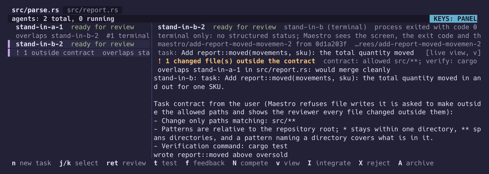
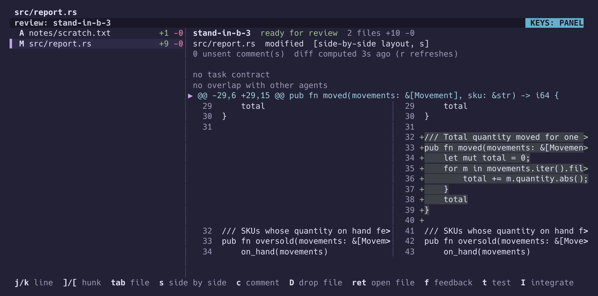
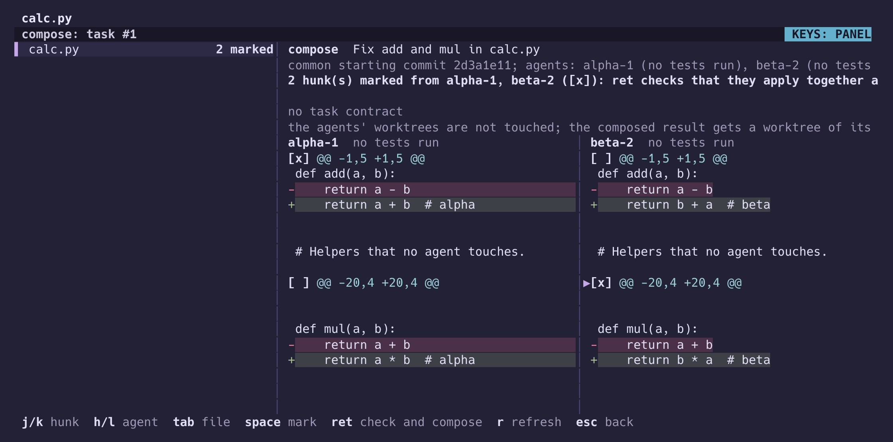
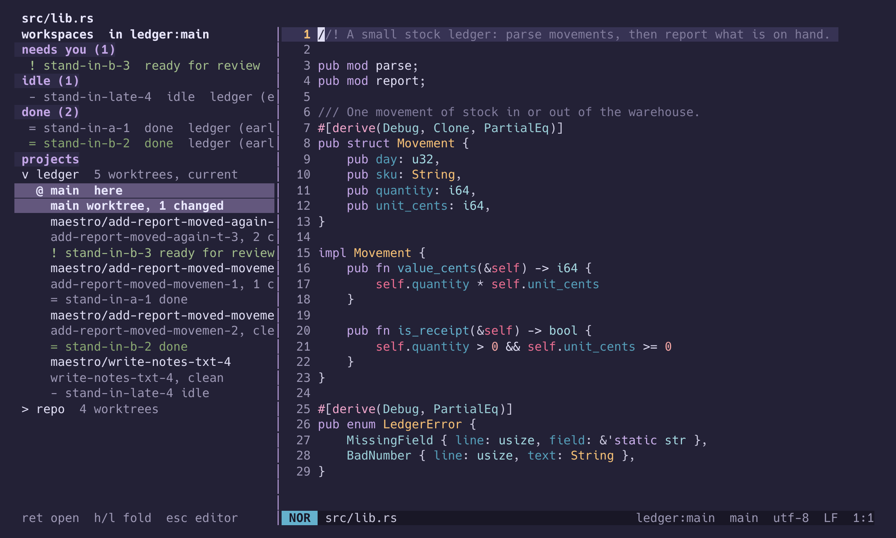
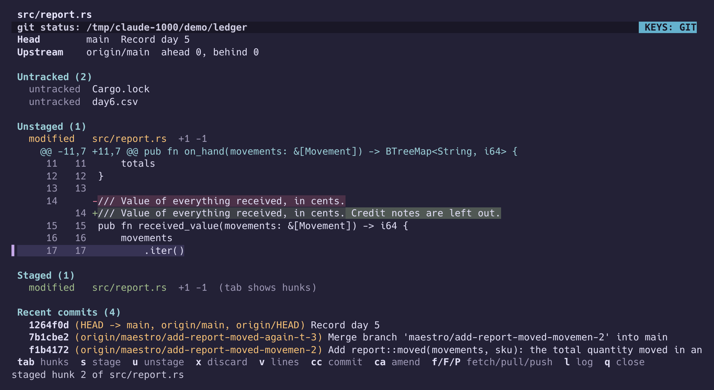
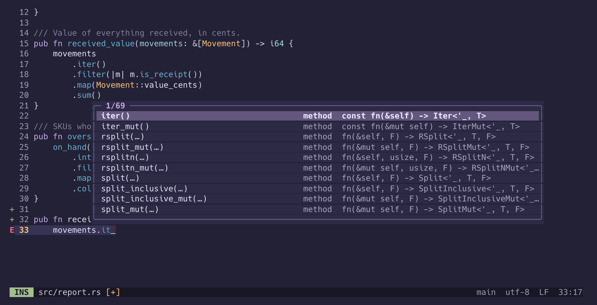

# Maestro

A modal terminal editor, written in Rust, for working next to coding agents. Start Claude Code, Codex or any command-line agent from the editor. Each one gets its own Git worktree and branch. Then review what it did, keep the hunks you want, and merge them.

It also has to be a good editor with no agent running, so the editing core comes first: multiple selections in the Helix and Kakoune style, language servers, tree-sitter, and a Git screen in the style of Magit.



### Review an agent's work, then merge all of it or only some hunks



### Take the best hunks from several agents

Two agents fixed the same file. Mark a hunk from each, and Maestro checks that they apply together and commits the result on a branch of its own.



### Every project, worktree and agent in one sidebar

Agents are sorted by what they need from you. Enter on a worktree switches the editor to it and brings back the files you had open there.



### Git without leaving the editor

Stage a file, a hunk or single lines, then commit, fetch, pull and push.



### Edit by syntax tree

![A pipeline typed in the command line: select every pub fn, keep the ones that return Result, and insert #[must_use] above each.](docs/images/pipeline.png)

### Language servers



There is also a GitHub inbox (`space i`) of the pull requests and issues waiting on you, through the `gh` CLI. Approving, commenting and merging all show the exact `gh` command first and wait for `y`.

The screenshots are real runs in a 120 by 34 terminal. The agents in them are small scripts set up as terminal agents, so the shots can be taken again; Claude Code and Codex run the same way.

## Install

Needs Rust 1.88 or newer to build, and Git 2.38 or newer to run agents' merge checks. Developed on Linux; CI also builds and tests on macOS.

```sh
git clone https://github.com/tbosier/maestro
cd maestro
cargo build --release
./target/release/maestro path/to/file.rs
./target/release/maestro path/to/file.rs:42   # open at line 42
```

## First keys

| Keys | Does |
|---|---|
| `:w` / `:q` | save / quit |
| `space ?` | every command, with its key |
| `space f` / `space /` | find a file / search the workspace |
| `space a` | agents: `n` new task, `i` or a click to type into one, `m` message it, `ret` review, `I` integrate |
| `space g` | Git status |
| `space s` | projects and worktrees |
| `space j` | jump to a project, worktree, agent or buffer |
| `space i` | GitHub inbox |

Pressing `space`, `g`, `m` or `C-w` shows what can follow.

## Status

Early, version 0.x. Claude Code and Codex have been run through the agent panel on a real task. Agents that speak the Agent Client Protocol are tested only against a fake agent so far. There is no OS sandbox for agents yet: a worktree keeps their files apart, not their permissions. [ROADMAP.md](ROADMAP.md) says exactly what works.

## More

- [docs/guide.md](docs/guide.md): every feature, every key, and the config file.
- [ARCHITECTURE.md](ARCHITECTURE.md): crates and main types.
- [docs/security.md](docs/security.md): trust boundaries.
- [docs/performance.md](docs/performance.md): how performance is measured, and the numbers.
- [docs/automation.md](docs/automation.md): the JSON-RPC API for agents and scripts.
- [CONTRIBUTING.md](CONTRIBUTING.md) and [AGENTS.md](AGENTS.md): how to work on it.

## License

MIT. The Duskfox palette comes from [nightfox.nvim](https://github.com/EdenEast/nightfox.nvim) by EdenEast, MIT licensed; see `third_party/`.
